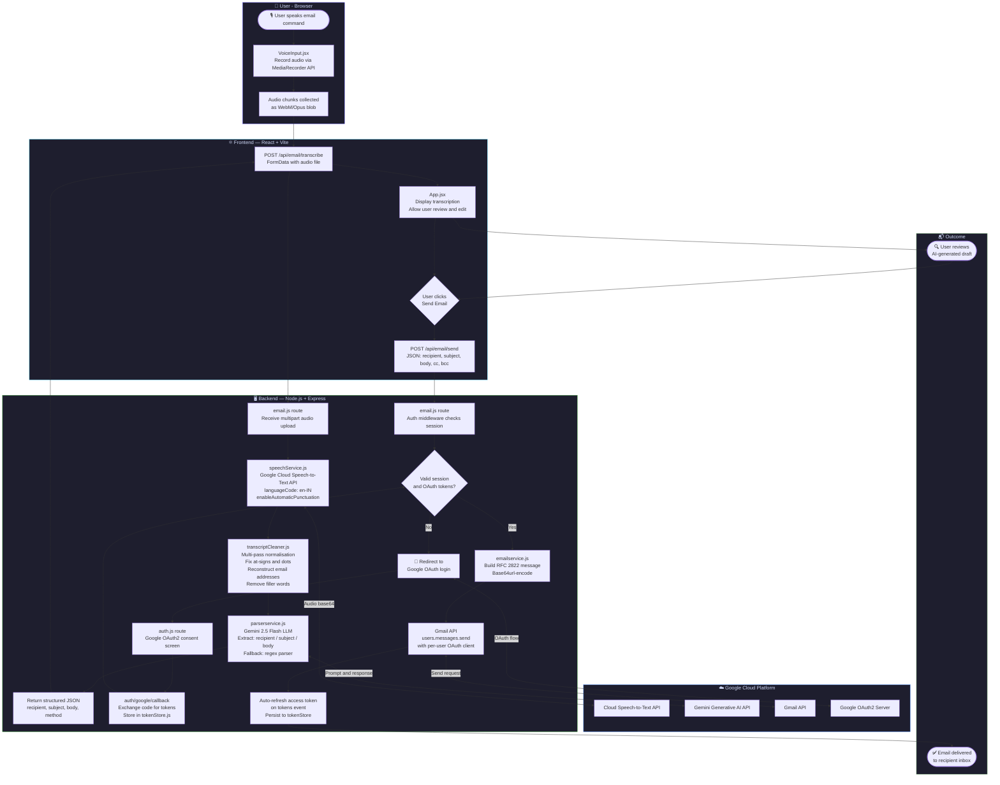

# 🎙️ AI Voice Email Assistant

<div align="center">


**Compose and send emails using just your voice — powered by Google Cloud Speech-to-Text, Gemini AI, and the Gmail API.**

[Features](#-features) • [Pipeline](#-complete-pipeline) • [Tech Stack](#-tech-stack) • [Setup](#-setup-instructions) • [Usage](#-usage) • [Deployment](#-deployment)

</div>

---

## ✨ Features

| Feature | Description |
|---|---|
| 🎤 **Voice Input** | Record voice directly from any browser — no plugin required |
| 📝 **Speech-to-Text** | Accurate transcription tuned for Indian English (`en-IN`) via Google Cloud STT |
| 🤖 **AI Parsing** | Gemini 2.5 Flash extracts recipient, subject, and body from natural speech |
| 🧹 **Transcript Cleaning** | Multi-pass cleaner normalises email addresses & corrects spoken punctuation |
| 📧 **Gmail Integration** | Sends email via Gmail API using the signed-in user's own Google account |
| 🔐 **OAuth 2.0 Auth** | Secure per-user authentication — no passwords stored |
| 🔄 **Token Auto-Refresh** | Access tokens are silently refreshed; sessions persist across visits |
| ⚡ **Modern UI** | React + Vite SPA with real-time status feedback and toast notifications |

---

## 🔄 Complete Pipeline

The diagram below traces a single user request — from speaking into the microphone to the email landing in the recipient's inbox.



### Pipeline Summary

| Step | Component | Description |
|---|---|---|
| 1 | `VoiceInput.jsx` | Browser records audio via `MediaRecorder` API |
| 2 | `speechService.js` | Sends audio to Google Cloud STT → raw transcript |
| 3 | `transcriptCleaner.js` | Normalises spoken email addresses and grammar |
| 4 | `parserservice.js` | Gemini extracts structured `{recipient, subject, body}` |
| 5 | `App.jsx` | User reviews and optionally edits the AI draft |
| 6 | `emailservice.js` | Builds RFC 2822 message and sends via Gmail API |
| 7 | `tokenStore.js` | Refreshes and persists OAuth tokens transparently |

---

## 🛠️ Tech Stack

### Frontend
| Package | Version | Purpose |
|---|---|---|
| React | 18 | UI framework |
| Vite | Latest | Dev server & bundler |
| Lucide React | Latest | Icon set |
| React Toastify | Latest | Toast notifications |

### Backend
| Package | Purpose |
|---|---|
| Node.js & Express | HTTP server & routing |
| `@google-cloud/speech` | Speech-to-Text transcription |
| `@google/generative-ai` | Gemini AI for NLP parsing |
| `googleapis` | Gmail API & OAuth2 |
| `express-session` + `session-file-store` | Persistent user sessions |
| `multer` | Multipart audio file uploads |

---

## 📁 Project Structure

```text
email-agent-app/
├── README.md
├── deployment_guide.md        # Full guide: localhost → Vercel + Render
└── new/
    ├── backend/               # Node.js + Express API server
    │   ├── config/
    │   │   ├── oauth.js       # OAuth2 client factory
    │   │   └── tokenStore.js  # Per-user token persistence
    │   ├── middleware/
    │   │   └── authCheck.js   # Session auth guard
    │   ├── routes/
    │   │   ├── auth.js        # /auth/google, /auth/google/callback, /auth/logout
    │   │   └── email.js       # /api/email/transcribe, /api/email/send
    │   ├── services/
    │   │   ├── speechService.js       # Google Cloud STT wrapper
    │   │   ├── transcriptCleaner.js   # Multi-pass transcript normaliser
    │   │   ├── parserservice.js       # Gemini + regex email parser
    │   │   └── emailservice.js        # Gmail API sender
    │   ├── .env.example       # Template for required environment variables
    │   └── server.js          # Express app entry point
    └── frontend/              # React + Vite SPA
        ├── public/
        └── src/
            ├── components/
            │   ├── AuthStatus.jsx   # Login/logout UI
            │   ├── VoiceInput.jsx   # Microphone recorder
            │   ├── EmailPreview.jsx # AI draft preview & edit
            │   ├── TextInput.jsx    # Manual text input fallback
            │   └── StatusMessage.jsx
            ├── utils/
            │   └── api.js           # Axios API wrapper
            ├── App.jsx              # Root component & state machine
            └── index.css            # Global styles
```

---

## ⚙️ Setup Instructions

### Prerequisites
- **Node.js** v16 or higher
- A **Google Cloud Console** project with these APIs enabled:
  - ✅ Cloud Speech-to-Text API
  - ✅ Gmail API
  - ✅ Generative Language API (Gemini)
- A **Service Account** with Speech-to-Text permissions (download `google-credentials.json`)
- **OAuth 2.0 Web Client** credentials configured in Google Cloud Console

---

### 1. Clone & Configure Credentials

```bash
git clone https://github.com/YOUR_USERNAME/email-agent-app.git
cd email-agent-app/new/backend
```

Place your downloaded `google-credentials.json` (OAuth2 Web Client) in `new/backend/`.

Create a `.env` file in `new/backend/`:

```env
PORT=3000
SESSION_SECRET=your_super_secret_session_key_min_32_chars

# Gemini AI
GEMINI_API_KEY=your_gemini_api_key_here
GEMINI_MODEL=gemini-2.5-flash

# Google OAuth2 (from Google Cloud Console)
GOOGLE_CLIENT_ID=your_client_id.apps.googleusercontent.com
GOOGLE_CLIENT_SECRET=your_client_secret
GOOGLE_REDIRECT_URI=http://localhost:3000/auth/google/callback

# Speech-to-Text service account (local dev — use file path)
GOOGLE_APPLICATION_CREDENTIALS=./google-credentials.json
```

---

### 2. Start the Backend

```bash
cd new/backend
npm install
npm run dev
```

> 🟢 Server starts at `http://localhost:3000`

---

### 3. Start the Frontend

```bash
cd new/frontend
npm install
npm run dev
```

> 🟢 Vite dev server starts at `http://localhost:5173`

---

## 🚀 Usage

1. **Open** `http://localhost:5173` in your browser.
2. **Sign in** with your Google account via the OAuth popup.
3. **Click the microphone** and speak your email command naturally:
   > *"Send an email to john@gmail.com with subject Meeting Tomorrow and body Hi John, are you free at 3pm?"*
4. **Review** the AI-generated draft — edit any field if needed.
5. **Click Send** to deliver the email via your Gmail account.

---

## ☁️ Deployment

This project is designed to deploy on:

| Layer | Platform | Notes |
|---|---|---|
| Frontend | [Vercel](https://vercel.com) | Auto-deploys on `git push` |
| Backend | [Render](https://render.com) | Free tier available |
| Auth & APIs | Google Cloud | OAuth2, STT, Gemini, Gmail |

See the full step-by-step guide in [deployment_guide.md](./deployment_guide.md), which covers:
- Pushing to GitHub safely (without secrets)
- Deploying the backend on Render with all environment variables
- Deploying the frontend on Vercel
- Configuring Google OAuth for production
- Securely passing the Speech-to-Text service account via environment variables
- Troubleshooting common errors (`redirect_uri_mismatch`, CORS, cold starts)

---

## 🔐 Security Notes

- **Never commit** `.env`, `google-credentials.json`, or `tokens.json` to version control — all are in `.gitignore`.
- OAuth tokens are stored server-side in encrypted session files, not in the browser.
- The Speech-to-Text service account JSON is loaded from an environment variable in production (never a file on disk).
- Cookies are set with `httpOnly: true`, `secure: true`, and `sameSite: 'none'` in production.

---

## 📄 License

MIT © 2026
